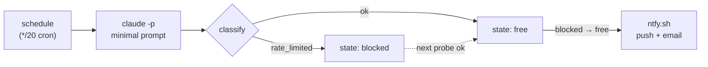

<div align="center">

# back-in-claude

**Know the moment your Claude 5-hour usage window reopens.**

A GitHub Actions template that probes your Claude subscription on a schedule<br>
and sends a phone push and an email when the limit resets. Nothing runs on your machine.

[](https://github.com/jackchuka/back-in-claude/actions/workflows/ci.yml)
[](https://github.com/jackchuka/back-in-claude/actions/workflows/probe.yml)
[](LICENSE)



[How It Works](#how-it-works) · [Setup](#setup) · [Notifications](#notifications) · [Security](#security) · [Development](#development)

</div>

---

When you hit the Claude 5-hour usage limit, the only way to find out it has reset is to keep trying. **back-in-claude** does the trying for you: a scheduled workflow runs one tiny Claude Code prompt, and the first time it succeeds after being rate-limited, it sends you a notification through [ntfy](https://ntfy.sh).

Full rationale, including the alternatives that were rejected and why, is in [docs/DESIGN.md](docs/DESIGN.md).

## Features

- **Runs entirely in GitHub Actions** — no daemon, no laptop that has to stay awake
- **Push and email in one call** — a single ntfy POST reaches the ntfy app and, optionally, your inbox
- **Notifies on transitions only** — `blocked → free` triggers the alert; repeated `ok` results stay silent
- **Fail-safe classification** — anything not confidently recognised is an `error`, never a false all-clear
- **Self-monitoring** — weekly heartbeat, a warning after repeated probe errors, and an alert when the token is rejected
- **Quiet history** — `state.json` is committed only when the state means something new
- **Hardened workflows** — SHA-pinned actions, a `main`-restricted environment for secrets, and `zizmor` in CI
- **Zero runtime dependencies** — plain TypeScript run natively by Node 24, no build step

## How It Works

A scheduled job runs one minimal Claude Code prompt using a subscription-issued `CLAUDE_CODE_OAUTH_TOKEN`. Rate-limited means still blocked; success means the window is open. The `blocked → free` transition sends the notification.

Each probe is classified as one of:

| Result         | Meaning                                      |
| -------------- | -------------------------------------------- |
| `ok`           | The prompt succeeded; the window is open     |
| `rate_limited` | The usage limit is still in effect           |
| `auth_failed`  | The token was rejected                       |
| `error`        | Anything else, including unrecognised output |

**Cost.** Every delivered tick probes, so the cron expression is the only throttle and also the entire budget. `*/20` caps the cost at 72 probes/day and detects a reset within 20 minutes. A probe costs 4,692 cache-creation input tokens plus 16 output tokens, about $0.047 (measured, not estimated). At `*/20` that is under 1% of a normal working day's usage, and less in practice: GitHub delivers scheduled workflows on public repositories unreliably, closer to one tick per hour than three.

| Schedule | Probes/day at 100% delivery |
| -------- | --------------------------- |
| `*/10`   | 144                         |
| `*/20`   | 72 (default)                |
| `*/30`   | 48                          |

## Setup

1. **[Use this template](https://github.com/new?template_name=back-in-claude&template_owner=jackchuka)** to create your own repository.

2. Generate a long-lived subscription token:

   ```bash
   claude setup-token
   ```

3. Pick an unguessable ntfy topic and subscribe to it in the [ntfy app](https://ntfy.sh/app). Save the value somewhere; you cannot read it back out of GitHub later:

   ```bash
   openssl rand -hex 12
   ```

4. **Create a `production` environment** (Settings → Environments → New environment) and restrict its deployment branches to `main` only. Add the secrets there rather than at repository level, so a workflow running on any other ref cannot read them:

   | Secret                    | Value                          |
   | ------------------------- | ------------------------------ |
   | `CLAUDE_CODE_OAUTH_TOKEN` | output of `claude setup-token` |
   | `NTFY_TOPIC`              | the random string from step 3  |
   | `NOTIFY_EMAIL`            | optional, for email delivery   |

5. **Protect `main` with rules the bot can survive.** The workflow pushes `state.json` directly to `main` on every state transition, a handful of times a day. Use a **ruleset** (Settings → Rules → Rulesets), not classic branch protection:

   - Target branch: `main`
   - Enable **Restrict deletions** and **Block force pushes**. Neither blocks a normal fast-forward push.
   - **Do not enable _Require a pull request before merging_ or _Require status checks to pass_.** Both reject direct pushes (a direct push has no check run attached to its commit). Either one makes every state commit fail to push: the run goes red, the transition is lost, and the next probe re-detects the same reset and notifies again.

   > [!NOTE]
   > On an **organisation-owned** repository you can keep those two rules by adding the `GitHub Actions` app as a **bypass actor**. On a **personal** repository you cannot (GitHub rejects it with _"Actor GitHub Actions integration must be part of the ruleset source or owner organization"_), so the rules above are the only workable configuration.

   You lose no visibility: `ci.yml` still runs on every push and pull request. What you give up is the ability to _block_ a merge on it. The workflow file is the sensitive asset, since anyone who can change it can read the token; review any pull request touching `.github/workflows/` accordingly.

6. **Trigger a first run** to confirm everything is wired:

   ```bash
   gh workflow run probe.yml
   ```

   It reports `result=ok` and sends nothing. That is correct: the first run is silent by design (see below).

## Notifications

| Title                        | Priority | When                                                                      |
| ---------------------------- | -------- | ------------------------------------------------------------------------- |
| **Claude limit reset**       | default  | The 5-hour window reopened (`blocked → free`)                             |
| **Claude watchdog alive**    | low      | Weekly heartbeat. If it stops arriving, something is wrong                |
| **Claude watchdog degraded** | high     | Four consecutive probe errors; reset detection may be delayed             |
| **Claude watchdog is down**  | high     | The token was rejected. Re-run `claude setup-token` and update the secret |

A reset notification looks like this in ntfy:

```text
Claude limit reset
5-hour window is open again.
```

### Behaviour Worth Knowing

- **The first run is silent.** State starts `unknown`, and `unknown → free` never notifies: there is no evidence a limit was ever hit, so an all-clear would be fabricated.
- **The 60-day rule.** GitHub disables scheduled workflows in public repos after 60 days without repository activity, and only new commits reset that timer. State commits normally prevent this; the weekly heartbeat makes a dead watchdog visible if it happens anyway. Fix it with `gh workflow enable probe.yml`.
- **The CLI cache key freezes the installed version.** `claude-cli-v1` in `probe.yml` pins whatever CLI build was cached under that key until the key is bumped. An expired or incompatible CLI surfaces as `auth_failed`, which notifies immediately.
- **`git log` is public and records your limit transitions.** Commits land only on real state changes, but on a public repository the timestamps still show roughly when you get capped and when the window reopens. Use a private repo if that matters.

## Security

> [!WARNING]
> A copy of this template holds a secret equivalent to **full Claude account access**. Read [SECURITY.md](SECURITY.md) before deploying it. It covers the residual risks as well as the mitigations, including the ones that have not been eliminated.

This setup is safe only because of specific choices, all of which must be preserved:

- **Triggers are `schedule` and `workflow_dispatch` only.** **Never add `pull_request_target`, `issue_comment`, or `workflow_run`**: these run untrusted fork code with access to your secrets. `pull_request` is safe and is used by `ci.yml`, which holds no secrets.
- **The token lives in a `main`-restricted environment**, so a workflow on any other ref cannot read it.
- **All actions are SHA-pinned**, and Dependabot keeps those pins current. Review those PRs rather than merging them blindly.
- **No untrusted interpolation.** Nothing from `github.event.*` is referenced in any `run:` block. Secrets reach the process through `env:` only.
- **`zizmor` runs in CI** and enforces the workflow half of these rules, so a future misconfiguration fails the build rather than shipping.
- **Raw CLI output is never logged.** It carries `session_id`, cost, and usage figures, and public run logs are world-readable. As a consequence, an `error` classification cannot be debugged from the logs beyond its exit code and stream lengths; reproduce locally instead.
- **`CLAUDE_CODE_OAUTH_TOKEN` cannot be scoped down.** Rotation (re-running `claude setup-token` and updating the secret) is the only mitigation if you suspect exposure.

**If you would rather not put an account token in a public repository**, create your copy as a **private** repo. Everything works the same, but Actions minutes count against your own quota and private repos bill each run at a one-minute floor, so drop the schedule in `probe.yml` to `*/30` and expect slower detection. GitHub Free offers Environments on public repositories only, so on a private copy use repository secrets and remove the `environment:` line from `probe.yml`.

## Development

```bash
npm install
npm run check      # typecheck + lint + fmt:check + test
npm run probe      # run one probe locally (needs the env vars above)
```

| Script              | Runs                                   |
| ------------------- | -------------------------------------- |
| `npm run typecheck` | `tsc --noEmit`                         |
| `npm run lint`      | `oxlint --type-aware`                  |
| `npm run lint:fix`  | `oxlint --fix --type-aware`            |
| `npm run fmt`       | `oxfmt`                                |
| `npm run fmt:check` | `oxfmt --check`                        |
| `npm test`          | `node --test`, TypeScript run natively |

Toolchain: TypeScript 7 (the Go-native `tsc`), oxlint with type-aware checking via `oxlint-tsgolint`, and oxfmt. No build step: Node 24+ strips types natively. Zero runtime dependencies.

## License

[MIT](LICENSE) © jackchuka
